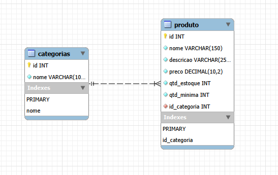

# Organiza Comercial - API de Produtos e Estoque

API REST em Node.js e Express para gerenciamento de produtos, categorias e estoque, organizada em MVC e integrada ao MySQL por meio de `mysql2`.

## Requisitos

- Node.js 18 ou superior
- MySQL 8.0.16 ou superior (para aplicar as restrições `CHECK` do script)

## Configuração e execução

1. Na pasta `backend`, instale as dependências:

   ```sh
   npm install
   ```

2. Crie o banco e as tabelas executando `src/config/script.sql` no MySQL Workbench ou no cliente MySQL.
3. Copie `.env.example` para `.env` e preencha as configurações do seu MySQL:

   ```text
   PORT=3042
   DB_HOST=localhost
   DB_USER=seu_usuario
   DB_PASSWORD=sua_senha
   DB_PORT=3306
   DB_NAME=controleDeEstoque
   ```

   No PowerShell, a cópia pode ser feita com `Copy-Item .env.example .env`.
4. Inicie em desenvolvimento com `npm run dev`, ou em execução normal com `npm start`.
5. A API estará disponível em `http://localhost:3042` (ou na porta definida em `PORT`).

Não versionar nem compartilhar o arquivo `.env` com credenciais reais.

## Rotas

### Produtos

Base: `/produtos`

| Método | Rota | Descrição |
|---|---|---|
| GET | `/produtos` | Lista os produtos; aceita filtros por query string |
| GET | `/produtos?categoria=2` | Filtra por ID da categoria |
| GET | `/produtos?estoque=normal` | Filtra estoque normal |
| GET | `/produtos?estoque=baixo` | Filtra estoque baixo |
| GET | `/produtos?estoque=sem_estoque` | Filtra produtos sem estoque |
| GET | `/produtos?categoria=2&estoque=baixo` | Combina os filtros |
| GET | `/produtos/:id` | Consulta um produto pelo ID |
| POST | `/produtos` | Cadastra um produto |
| PUT | `/produtos/:id` | Substitui todos os dados do produto |
| PATCH | `/produtos/:id` | Atualiza somente os campos informados |
| DELETE | `/produtos/:id` | Exclui um produto |

Situações do estoque:

- `normal`: quantidade disponível maior que a quantidade mínima.
- `baixo`: quantidade disponível maior que zero e menor ou igual à quantidade mínima.
- `sem_estoque`: quantidade disponível igual a zero.

Exemplo de corpo para cadastro ou substituição completa:

```json
{
  "nome": "Arroz",
  "descricao": "Pacote de arroz de 5kg",
  "preco": 28.9,
  "qtd_estoque": 50,
  "qtd_minima": 10,
  "id_categoria": 2
}
```

Exemplo de atualização parcial:

```json
{
  "qtd_estoque": 8
}
```

O preço deve ser maior que zero; as quantidades devem ser inteiros não negativos; e a categoria informada deve existir.

### Categorias

Base: `/categorias`

| Método | Rota | Descrição |
|---|---|---|
| GET | `/categorias` | Lista todas as categorias |
| GET | `/categorias/:id` | Consulta uma categoria |
| POST | `/categorias` | Cadastra uma categoria |
| PUT | `/categorias/:id` | Atualiza o nome da categoria |
| DELETE | `/categorias/:id` | Exclui uma categoria sem produtos associados |

Exemplo de corpo:

```json
{
  "nome": "Bebidas"
}
```

Erros de validação retornam HTTP 400, registros inexistentes retornam HTTP 404, conflitos de integridade retornam HTTP 409 e falhas inesperadas retornam HTTP 500 sem expor detalhes internos.

## DER


