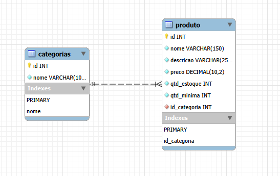

 # Organiza Comercial — API de Produtos e Estoque

API REST desenvolvida em Node.js para gerenciamento de produtos, categorias e controle de estoque, utilizando o padrão MVC e banco de dados MySQL.

## Tecnologias

- Node.js
- Express
- MySQL

## Bibliotecas

- `express` — criação do servidor e das rotas da API.
- `mysql2` — conexão e consultas ao banco de dados MySQL.
- `dotenv` — gerenciamento das variáveis de ambiente.


## DER


## Como executar o projeto

### 1. Execute database/script.sql no MySQL Worckbench;

### 2. Abra um terminal na pasta do projeto e execute:

npm init -y

### 3. Depois execute:

npm install node nodemon express dotenv mysql2

### 4. Copie .env.example para .env e ajuste usuário, senha e demais configurações;

### 5. Execute npm run dev para desenvolvimento ou npm start para execução normal;

### 6. A API ficará disponível em http://localhost:3042.

Não compartilhe o arquivo .env nem inclua credenciais reais no repositório.

## Rotas da API

### Produtos

Base: `/produtos`

| Método | Rota | Descrição |
|---|---|---|
| GET | `/produtos` | Lista todos os produtos |
| GET | `/categoria/:categoria` | Buscar produtos pela categoria |
| GET | `/produtos/:id` | Busca um produto pelo ID |
| POST | `/produtos` | Cadastra um produto |
| PUT | `/produtos/:id` | Atualiza os dados de um produto |
| DELETE | `/produtos/:id` | Exclui um produto |

Os filtros por categoria e situação são independentes. Envie apenas um deles por requisição.

Exemplo de corpo para POST/PUT

```json
{
    "nome": "Arroz",
    "descricao": "Pacote de arroz de 5kg",
    "preco": 28.90,
    "qtd_estoque": 50,
    "qtd_minima": 10,
    "id_categoria": 2
}
```

### Categorias

Base: `/categorias`

| Método | Rota | Descrição |
|---|---|---|
| GET | `/categorias` | Lista todas as categorias |
| GET | `/categorias/:id` | Busca uma categoria pelo ID |
| POST | `/categorias` | Cadastra uma categoria |
| PUT | `/categorias/:id` | Atualiza uma categoria |
| DELETE | `/categorias/:id` | Exclui uma categoria |


Exemplo de corpo para POST/PUT

```json
{
    "nome": "Bebidas"
}
```